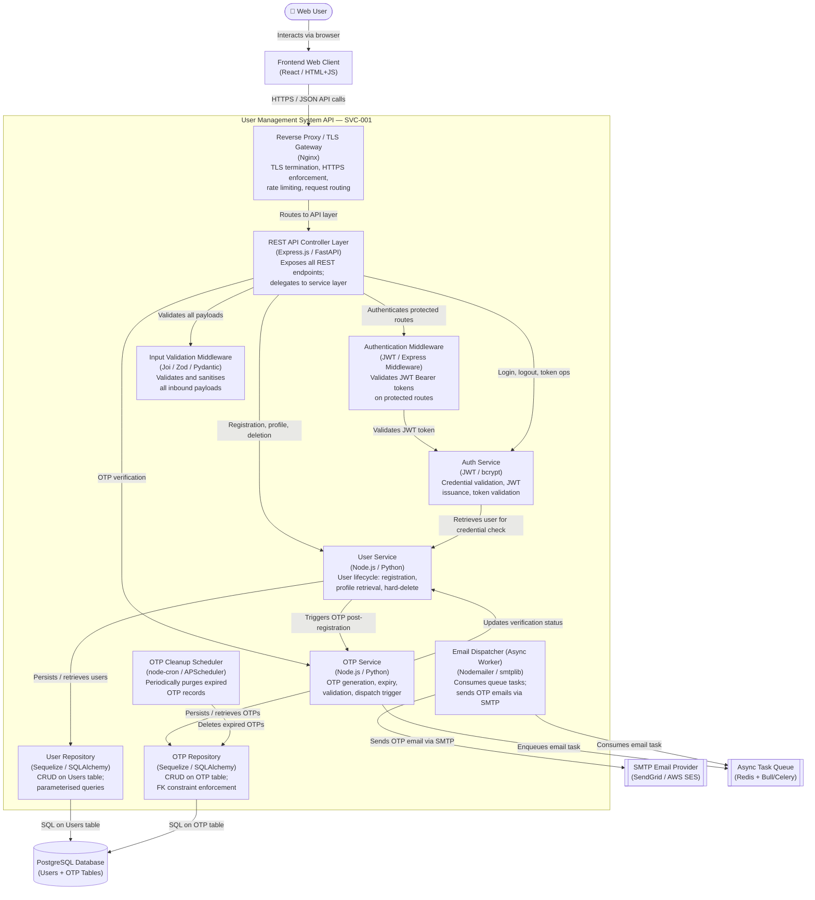

# User Management System API

## C3 — Summary

This C3 Component Diagram details the internal logical architecture of the User Management System API (SVC-001), a monolithic N-Tier application implementing a Layered (Controller → Service → Repository) architecture. The diagram exposes 11 internal components organized across four layers: Infrastructure/Presentation (Reverse Proxy, REST API Controller, Authentication Middleware, Input Validation Middleware), Business Logic (User Service, Auth Service, OTP Service), Data Access (User Repository, OTP Repository), and Integration/Background (Email Dispatcher, OTP Cleanup Scheduler). The service handles the complete user lifecycle across three features: User Registration with Email OTP Verification (F-01), Secure User Login and Session Management (F-02), and Account Deletion (F-03). External dependencies include a PostgreSQL database for persistent storage, a Redis-backed async task queue for decoupled OTP email dispatch, and an SMTP Email Provider for actual email delivery. The Frontend Web Client and end users are modeled as external consumers of the service boundary.

## C3 — Insights

- Layered N-Tier Architecture: The service strictly separates concerns across Controller (HTTP handling), Service (business logic), and Repository (data access) layers, ensuring testability, maintainability, and clear ownership boundaries for each of the 3 features.
- Stateless JWT Authentication: The Auth Service issues signed JWT tokens with no server-side session storage, enabling horizontal scaling without sticky sessions. The Authentication Middleware performs local cryptographic validation on every protected request, avoiding per-request DB lookups and supporting the ~500 concurrent users target.
- Async OTP Email Dispatch: The Email Dispatcher is fully decoupled from the registration request-response cycle via a Redis-backed task queue. This ensures the registration API meets its 2-second SLA regardless of SMTP provider latency or transient failures.
- Hard-Delete with Cascading Integrity: The User Service executes hard-deletes (not soft-deletes) on account deletion per F-03 requirements, with PostgreSQL FK CASCADE DELETE ensuring all associated OTP records are atomically removed, preventing orphaned PII and partial deletion states.
- Dual-Layer Input Defense: Input Validation Middleware provides the first line of defense (schema validation, sanitisation against XSS/injection) before requests reach business logic, while service-layer checks (email uniqueness, bcrypt hashing) provide the second layer, implementing defense-in-depth.
- Session-Derived Ownership Enforcement: The Authentication Middleware and Auth Service together ensure that the DELETE /api/users/me endpoint derives the target account exclusively from the validated JWT session — never from client-supplied identifiers — satisfying US-004 and US-005 ownership enforcement requirements.
- OTP Lifecycle Integrity: The OTP Service enforces single-use (is_used flag) and 5-minute TTL constraints, with the OTP Cleanup Scheduler periodically purging expired records to maintain OTP table hygiene and prevent replay attacks on stale codes.
- Reverse Proxy as Lightweight API Gateway: Nginx acts as the single public-facing entry point, handling TLS termination, HTTPS enforcement, HTTP-to-HTTPS redirects, and rate limiting on sensitive endpoints (login, OTP generation) before traffic reaches the application tier.
- Repository Pattern for Data Isolation: User Repository and OTP Repository abstract all SQL/ORM interactions behind typed interfaces, preventing business logic from containing raw queries and enabling independent testing of service components with mock repositories.
- bcrypt Password Security: The User Service applies bcrypt hashing (work factor ≥12) to all passwords before any persistence call, ensuring plaintext passwords never reach the repository or database layer, satisfying US-018 secure credential storage requirements.

## C3 — Interfaces

### Public REST API (REST / HTTPS / JSON)
All externally-facing RESTful HTTP endpoints exposed by the REST API Controller Layer for client consumption over HTTPS. Covers all three features: registration, login/session management, and account deletion.

- POST /api/v1/auth/register — Submit name, email, password to initiate registration
- POST /api/v1/auth/verify-otp — Submit email and OTP code to verify email and activate account
- POST /api/v1/auth/login — Submit email and password; receive JWT on successful authentication
- POST /api/v1/auth/logout — Invalidate client-side JWT session
- GET /api/v1/dashboard — Authenticated; retrieve user profile data for dashboard display
- DELETE /api/v1/account — Authenticated; initiate permanent account deletion
- GET /api/v1/health — Return application and database health status

### User Service Interface (In-process / Function Call)
Internal interface exposed by the User Service to the Controller Layer and other services for user lifecycle operations including registration, retrieval, and deletion.

- registerUser(name, email, password): UserDTO — Validate uniqueness, hash password, persist user in PENDING state
- getUserByEmail(email): UserEntity — Retrieve user record for authentication and duplicate checks
- getUserById(userId): UserDTO — Retrieve user profile for dashboard display
- deleteUser(userId): void — Execute hard-delete of user record with cascading OTP removal
- isEmailTaken(email): boolean — Check email uniqueness before registration proceeds

### Auth Service Interface (In-process / JWT)
Internal interface exposed by the Auth Service for credential validation, JWT lifecycle management, and token validation consumed by Auth Middleware.

- login(email, password): { token: JWT, user: UserDTO } — Validate credentials and issue JWT on success
- logout(): void — Instruct client to discard JWT token
- validateToken(token): DecodedTokenPayload — Validate JWT signature, expiry, and claims
- generateToken(userId, isVerified): JWT — Generate signed JWT with user identity and verification claims

### OTP Service Interface (In-process / Function Call)
Internal interface exposed by the OTP Service for OTP generation, dispatch, and verification operations.

- generateAndSendOTP(userId, email): void — Generate cryptographic OTP, persist with 5-min expiry, enqueue email dispatch
- verifyOTP(email, otpCode): boolean — Validate OTP existence, expiry, and single-use status; mark as used on success
- resendOTP(userId, email): void — Regenerate and resend OTP for unverified accounts
- invalidateExpiredOTPs(): void — Scheduled hook to purge expired OTP records

### User Repository Interface (ORM / Parameterised SQL / PostgreSQL)
Data access interface abstracting all PostgreSQL operations on the Users table, consumed by the User Service.

- create(userEntity): UserEntity — Insert new user record into Users table
- findByEmail(email): UserEntity | null — Query user by email address
- findById(userId): UserEntity | null — Query user by primary key
- updateVerificationStatus(userId, isVerified): void — Set is_verified flag on successful OTP confirmation
- deleteById(userId): void — Hard-delete user record with cascading OTP deletion

### OTP Repository Interface (ORM / Parameterised SQL / PostgreSQL)
Data access interface abstracting all PostgreSQL operations on the OTP table, consumed by the OTP Service and OTP Cleanup Scheduler.

- create(otpEntity): OTPEntity — Insert new OTP record with code, user_id, expiry, and is_used=false
- findByUserIdAndCode(userId, otpCode): OTPEntity | null — Retrieve OTP for validation
- findLatestByUserId(userId): OTPEntity | null — Retrieve most recent OTP for a user
- markAsUsed(otpId): void — Set is_used=true on successful OTP verification
- deleteExpired(): void — Remove OTP records where expires_at is in the past
- deleteByUserId(userId): void — Remove all OTP records for a deleted user

### Authentication Middleware Interface (Express Middleware / FastAPI Dependency Injection)
Cross-cutting middleware interface applied to all protected routes, validating JWT Bearer tokens before requests reach controllers.

- authenticate(request, response, next): void — Extract Bearer token, validate via Auth Service, attach user context or return HTTP 401

### Input Validation Middleware Interface (Joi / Zod / Pydantic)
Cross-cutting middleware interface applied to all inbound requests, enforcing schema validation and sanitisation before business logic is invoked.

- validateRegistration(request, response, next): void — Validate name, email, password fields and format
- validateOTPVerification(request, response, next): void — Validate email and 6-digit OTP code format
- validateLogin(request, response, next): void — Validate email and password field presence
- validateAccountDeletion(request, response, next): void — Validate authenticated deletion request structure

### Email Dispatcher Task Interface (Redis / Bull / Celery / SMTP)
Async task interface between the OTP Service and Email Dispatcher, mediated by the task queue for decoupled OTP email delivery.

- enqueueEmailTask(to: email, subject: string, body: string): void — OTP Service enqueues email task to queue
- processEmailTask(task): void — Email Dispatcher worker consumes and processes email task
- SMTP connection to external provider — Transmit composed OTP email via TLS-secured SMTP

### OTP Cleanup Scheduler Interface (node-cron / APScheduler)
Scheduled background interface triggering periodic OTP record purges via the OTP Repository.

- Scheduled cron trigger (every 15–30 minutes) — Invoke OTP Repository deleteExpired()
- deleteExpired(): void — Remove all OTP records where expires_at < NOW()

## C3 — Relationships

- ? -> ?
- ? -> ?
- ? -> ?
- ? -> ?
- ? -> ?
- ? -> ?
- ? -> ?
- ? -> ?
- ? -> ?
- ? -> ?
- ? -> ?
- ? -> ?
- ? -> ?
- ? -> ?
- ? -> ?

## C3 — External dependencies

- PostgreSQL Database: Primary relational data store hosting Users and OTP tables. Enforces unique email constraint, FK cascade deletes, and ACID transactional integrity for account deletion operations.
- Async Task Queue: Message broker decoupling OTP email dispatch from the registration request-response cycle. Ensures registration API meets 2-second SLA regardless of SMTP latency.
- SMTP Email Provider: External third-party email delivery service receiving OTP emails from the Email Dispatcher via TLS-secured SMTP. Manages deliverability, SPF/DKIM/DMARC compliance.
- Frontend Web Client: Client-side UI rendering 4 screens (Registration, OTP Verification, Login, Dashboard). Communicates exclusively with the service via HTTPS REST API calls.

## C3 — Diagram

## C4 — Classes

- AuthController
- UserController
- AuthMiddleware
- ValidationMiddleware
- GlobalExceptionHandler
- UserService
- AuthService
- OtpService
- OtpFactory
- IUserRepository
- IOtpRepository
- PostgresUserRepository
- PostgresOtpRepository
- EmailDispatcher
- TokenBlacklist

## C4 — Summary

This C4 Code diagram details the internal class structure of the User Management System API (SVC-001) — a Node.js/Express monolith implementing a strict Layered (N-Tier) architecture with four horizontal layers: Presentation, Application/Service, Infrastructure/Repository, and Domain. The diagram focuses on the design-critical classes and methods that carry real architectural decisions across all three product features (F-01 User Registration with OTP, F-02 Secure Login and Session Management, F-03 Account Deletion). Key design decisions shown include: Controller-Service-Repository (CSR) separation, repository interfaces for testability, JWT-based stateless auth with a TokenBlacklist for revocation, OtpFactory for secure OTP construction, async EmailDispatcher for SMTP decoupling, DTO boundaries at the API surface, and a GlobalExceptionHandler for centralised error mapping. The diagram deliberately omits trivial CRUD boilerplate and focuses on the classes and methods that encode the system's security, lifecycle, and integration contracts.

## C4 — Insights

- Strict CSR layering enforced: AuthController and UserController are kept thin — they only parse HTTP concerns and delegate all business logic to UserService and AuthService. No repository imports appear in controllers, preventing layer bypass (PAT-002).
- Repository interfaces (IUserRepository, IOtpRepository) are the dependency boundary between the Application and Infrastructure layers. PostgresUserRepository and PostgresOtpRepository implement these interfaces, enabling mock injection in unit tests without a real database (PAT-003).
- JWT stateless auth (PAT-005) is implemented via AuthService.issueToken() and AuthService.validateToken(). AuthMiddleware calls validateToken() and then checks TokenBlacklist.isBlacklisted() on every protected request — this is the critical design decision that enables server-side revocation on logout and account deletion (US-016, US-017).
- TokenBlacklist is the architectural answer to the stateless JWT revocation problem: when a user logs out (US-016) or deletes their account (US-002/F-03), AuthService.logout() and UserService.deleteAccount() both call TokenBlacklist.invalidate(), ensuring no previously issued token remains valid after these events.
- UserService.deleteAccount() is the transactional core of F-03: it must (1) verify session ownership via the JWT payload (never client-supplied IDs), (2) call TokenBlacklist.invalidate() for all active tokens, (3) call OtpRepository.deleteByUserId() to remove OTP data, and (4) call UserRepository.deleteById() — all within a single atomic operation to prevent partial deletion states (US-005 exception handling).
- OtpFactory centralises cryptographically secure OTP generation (PAT-008): OtpFactory.generateCode() uses crypto.randomInt (never Math.random), and OtpFactory.computeExpiry() enforces the 5-minute TTL. This single factory is the only place OTP construction logic lives, preventing drift across the codebase.
- EmailDispatcher.enqueue() decouples SMTP latency from the synchronous registration response (PAT-007), ensuring the 2-second registration SLA (US-008 AC) is met even under SMTP provider delays. The async dispatch path means OTP email failures do not fail the registration API call.
- ValidationMiddleware applies Joi/express-validator schema checks before AuthMiddleware on protected routes, implementing the middleware chain order: Input Validation → Authentication → Controller Handler (PAT-006). This rejects malformed requests before any JWT or DB lookup occurs.
- DTO boundary discipline (PAT-004): RegisterRequest, LoginRequest, VerifyOtpRequest are inbound DTOs; AuthResponse, UserResponse are outbound DTOs. hashedPassword, OTP codes, and internal flags (isUsed, deletedAt) are never included in response DTOs, preventing accidental PII/credential exposure.
- AccountStatus enum (PENDING → ACTIVE → DELETED) is the state machine governing the entire user lifecycle: PENDING blocks login (US-009), ACTIVE permits login and dashboard access, DELETED causes AuthService.login() to return a generic error without disclosing deletion status (US-011 anti-enumeration pattern).
- GlobalExceptionHandler is the single centralised error boundary: it maps AppError.statusCode to HTTP responses, ensuring 401/403 response contracts are uniformly applied across all auth-failure scenarios (US-005 ACs) and that no stack traces or sensitive data leak into error responses.
- JwtPayload carries only userId, isVerified, iat, and exp — no PII (name, email). This is the minimal-claims principle from PAT-005, reducing exposure if a token is intercepted and aligning with US-022 PII protection requirements.

## C4 — Methods

- **UserService.?** — Orchestrates registration: sanitises input, validates email uniqueness (throws ConflictError if duplicate), hashes password with bcrypt (work factor 12+), persists User with status=PENDING, triggers OtpService.generateAndDispatch(). Returns UserResponse DTO. Covers US-006, US-007, US-008.
- **UserService.?** — Transactional account deletion: (1) fetches user by userId from JWT payload only, (2) calls TokenBlacklist.invalidate() for all active tokens, (3) calls OtpRepository.deleteByUserId() to remove OTP data, (4) calls UserRepository.deleteById(). All steps wrapped in a DB transaction — partial deletion is prevented via rollback on any step failure. Covers US-002, US-004, US-005 (F-03).
- **UserService.?** — Verifies submitted OTP: fetches latest OTP for userId, checks isExpired(), checks isUsed, compares code. On success: marks OTP as used, updates User status PENDING→ACTIVE. On failure: throws ValidationError without activating account. Covers US-008, US-009 (F-01).
- **AuthService.?** — Four-condition credential validation: (1) findByEmail — throws generic AuthError if not found, (2) comparePassword — throws generic AuthError if mismatch, (3) checks status===ACTIVE — throws generic AuthError if PENDING or DELETED, (4) checks deletedAt===null. Anti-enumeration: identical generic error for all four failure paths (US-011). On success: calls issueToken(), returns AuthResponse DTO.
- **AuthService.?** — Server-side session invalidation: calls TokenBlacklist.invalidate(token, userId) to immediately revoke the token. Fails securely — if TokenBlacklist is unavailable, throws ServiceUnavailableError rather than silently succeeding (US-016 AC: fail-secure on session store unavailability).
- **AuthService.?** — Verifies JWT signature using HS256 and JWT_SECRET env var, checks exp claim. Throws UnauthorizedError on invalid signature, expiry, or malformed token. Called by AuthMiddleware on every protected request. Returns JwtPayload containing userId and isVerified (PAT-005).
- **AuthMiddleware.?** — Middleware entry point: extracts Bearer token from Authorization header (returns 401 if absent), calls AuthService.validateToken() (returns 401 on failure), calls TokenBlacklist.isBlacklisted() (returns 401 if blacklisted), attaches decoded JwtPayload to req.user, calls next(). Implements US-002, US-004, US-005 server-side enforcement.
- **OtpService.?** — Delegates OTP entity construction to OtpFactory.create(), persists via IOtpRepository.save(), then calls EmailDispatcher.enqueue(). Async dispatch ensures SMTP latency does not block the registration response (PAT-007). Covers US-008 AC: OTP dispatch triggered immediately after PENDING account creation.
- **OtpFactory.?** — Constructs a new OtpEntity: calls generateCode() using crypto.randomInt(100000, 999999) for a cryptographically secure 6-digit code, calls computeExpiry() returning Date.now()+5min, sets isUsed=false. Single source of truth for OTP construction — never uses Math.random() (PAT-008).
- **PostgresUserRepository.?** — Executes a hard DELETE on the Users table for the given id using a parameterised Prisma query. Called exclusively from UserService.deleteAccount() within a transaction. Enforces that the deletion is permanent and irreversible (F-03 requirement). No soft-delete — deletedAt is not used as a substitute for hard deletion.
- **TokenBlacklist.?** — Stores the token in the blacklist store (Redis or PostgreSQL sessions table) with a TTL equal to the token's remaining expiry time. Called on logout (US-016) and account deletion (US-017) to ensure immediate revocation. Prevents any window where a token remains valid after these events.
- **GlobalExceptionHandler.?** — Catches all unhandled errors propagated from controllers and middleware. Maps AppError.statusCode to HTTP response status. Ensures 401/403 response payloads conform to specified contracts (US-005 AC). Strips stack traces and sensitive data from all error responses in production (NODE_ENV check).

## C4 — Data structures

- User
- OtpEntity
- AccountStatus
- RegisterRequest
- LoginRequest
- VerifyOtpRequest
- AuthResponse
- UserResponse
- JwtPayload
- AppError

## C4 — Code relationships

- Controllers call service methods and map results to HTTP responses. Controllers never import repository classes — enforcing the CSR layer boundary (PAT-002). UserController.deleteAccount() passes only req.user.userId (from JWT payload) to UserService.deleteAccount(), never any client-supplied identifier (US-004 AC).
- AuthMiddleware calls AuthService.validateToken() for JWT cryptographic verification, then TokenBlacklist.isBlacklisted() for revocation check. Both checks must pass before req.user is populated and next() is called. This two-step check is the implementation of server-side session enforcement (US-004, US-015 ACs).
- UserService depends on the IUserRepository interface, not the concrete PostgresUserRepository. Concrete implementation is injected via DI at startup. This enables unit testing UserService with a mock repository without a real database.
- UserService.register() delegates OTP generation and dispatch to OtpService.generateAndDispatch(). UserService.verifyOtp() delegates to OtpService.verify(). This keeps OTP lifecycle logic cohesive in OtpService and UserService focused on user entity management.
- Both UserService.deleteAccount() and AuthService.logout() call TokenBlacklist.invalidate(). This dual-path invalidation ensures tokens are revoked on both explicit logout (US-016) and account deletion (US-017), with no window where a token remains valid after either event.
- AuthService.login() calls IUserRepository.findByEmail() to retrieve the user for credential validation. Depends on the interface, not the concrete class, for testability.
- OtpService.generateAndDispatch() calls OtpFactory.create() to construct the OtpEntity. OtpService never constructs OtpEntity directly — all OTP creation logic is centralised in OtpFactory, ensuring cryptographically secure code generation is always used.
- OtpService persists the OtpEntity via IOtpRepository.save(), then calls EmailDispatcher.enqueue() for async SMTP dispatch. The async enqueue ensures the registration API response is not blocked by SMTP latency (PAT-007, US-008 2-second SLA AC).
- Concrete Prisma-backed repository classes implement the repository interfaces. Registered in the DI container as the concrete bindings for IUserRepository and IOtpRepository. All SQL/ORM logic is encapsulated here — never in service classes (PAT-003).
- ValidationMiddleware executes before AuthMiddleware in the Express middleware chain for protected routes. This ensures malformed requests are rejected with HTTP 400 before any JWT validation or DB lookup occurs, reducing unnecessary load and preventing injection payloads from reaching business logic (US-019, US-021 ACs).
- User entity holds an AccountStatus enum value representing its lifecycle state. State transitions (PENDING→ACTIVE, ACTIVE→DELETED) are the only mutations to this field, performed exclusively by UserService methods, never by controllers or repositories directly.
- OtpEntity.userId is a foreign key referencing User.id. This association is used by OtpService.verify() to fetch the correct OTP for a given user, and by UserService.deleteAccount() to cascade-delete all OTP records for the deleted user (F-03 data removal requirement).

## C4 — Diagram

```mermaid
classDiagram
  direction TB

  %% ─── PRESENTATION LAYER ────────────────────────────────────────────────
  namespace PresentationLayer {
    class AuthController {
      +register(req RegisterRequest) Promise~UserResponse~
      +verifyOtp(req VerifyOtpRequest) Promise~MessageResponse~
      +login(req LoginRequest) Promise~AuthResponse~
      +logout(req AuthenticatedRequest) Promise~MessageResponse~
    }
    class UserController {
      +getDashboard(req AuthenticatedRequest) Promise~DashboardResponse~
      +deleteAccount(req AuthenticatedRequest) Promise~MessageResponse~
    }
    class AuthMiddleware {
      +validate(req, res, next) void
      -extractBearerToken(header string) string
      -verifyJwt(token string) JwtPayload
    }
    class ValidationMiddleware {
      +validateRegister(req, res, next) void
      +validateLogin(req, res, next) void
      +validateVerifyOtp(req, res, next) void
    }
    class GlobalExceptionHandler {
      +handle(err AppError, req, res, next) void
      -mapToHttpStatus(err AppError) number
    }
  }

  %% ─── APPLICATION / SERVICE LAYER ──────────────────────────────────────
  namespace ApplicationLayer {
    class UserService {
      +register(dto RegisterRequest) Promise~User~
      +verifyOtp(dto VerifyOtpRequest) Promise~void~
      +deleteAccount(userId string) Promise~void~
      -ensureEmailUnique(email string) Promise~void~
      -hashPassword(plain string) Promise~string~
      -sanitiseInput(input string) string
    }
    class AuthService {
      +login(dto LoginRequest) Promise~AuthResponse~
      +logout(userId string, token string) Promise~void~
      +issueToken(user User) string
      +validateToken(token string) JwtPayload
      -comparePassword(plain string, hash string) Promise~boolean~
      -buildJwtPayload(user User) JwtPayload
    }
    class OtpService {
      +generateAndDispatch(user User) Promise~void~
      +verify(userId string, code string) Promise~void~
      -isExpired(otp OtpEntity) boolean
    }
    class OtpFactory {
      +create(userId string, email string) OtpEntity
      -generateCode() string
      -computeExpiry() Date
    }
  }

  %% ─── INFRASTRUCTURE LAYER ─────────────────────────────────────────────
  namespace InfrastructureLayer {
    class IUserRepository {
      <<interface>>
      +findByEmail(email string) Promise~User~
      +findById(id string) Promise~User~
      +save(user User) Promise~User~
      +updateStatus(id string, status AccountStatus) Promise~void~
      +deleteById(id string) Promise~void~
    }
    class IOtpRepository {
      <<interface>>
      +save(otp OtpEntity) Promise~OtpEntity~
      +findLatestByUserId(userId string) Promise~OtpEntity~
      +markUsed(otpId string) Promise~void~
      +deleteByUserId(userId string) Promise~void~
    }
    class PostgresUserRepository {
      -db PrismaClient
      +findByEmail(email string) Promise~User~
      +findById(id string) Promise~User~
      +save(user User) Promise~User~
      +updateStatus(id string, status AccountStatus) Promise~void~
      +deleteById(id string) Promise~void~
    }
    class PostgresOtpRepository {
      -db PrismaClient
      +save(otp OtpEntity) Promise~OtpEntity~
      +findLatestByUserId(userId string) Promise~OtpEntity~
      +markUsed(otpId string) Promise~void~
      +deleteByUserId(userId string) Promise~void~
    }
    class EmailDispatcher {
      +enqueue(to string, otpCode string) Promise~void~
      -sendViaSMTP(to string, body string) Promise~void~
      -buildOtpEmailBody(code string) string
    }
    class TokenBlacklist {
      +invalidate(token string, userId string) Promise~void~
      +isBlacklisted(token string) Promise~boolean~
    }
  }

  %% ─── DOMAIN ENTITIES & DTOs ───────────────────────────────────────────
  namespace DomainLayer {
    class User {
      +id string
      +name string
      +email string
      +hashedPassword string
      +status AccountStatus
      +createdAt Date
      +deletedAt Date
    }
    class AccountStatus {
      <<enumeration>>
      PENDING
      ACTIVE
      DELETED
    }
    class OtpEntity {
      +id string
      +userId string
      +code string
      +expiresAt Date
      +isUsed boolean
      +createdAt Date
    }
    class RegisterRequest {
      +name string
      +email string
      +password string
    }
    class LoginRequest {
      +email string
      +password string
    }
    class VerifyOtpRequest {
      +userId string
      +code string
    }
    class AuthResponse {
      +token string
      +expiresIn number
    }
    class UserResponse {
      +id string
      +name string
      +email string
      +status string
    }
    class JwtPayload {
      +userId string
      +isVerified boolean
      +iat number
      +exp number
    }
    class AppError {
      +message string
      +statusCode number
      +code string
    }
  }

  %% ─── PRESENTATION → APPLICATION ───────────────────────────────────────
  AuthController ..> UserService : uses
  AuthController ..> AuthService : uses
  UserController ..> UserService : uses
  UserController ..> AuthService : uses
  AuthMiddleware ..> AuthService : validateToken()
  AuthMiddleware ..> TokenBlacklist : isBlacklisted()
  ValidationMiddleware ..> RegisterRequest : validates
  ValidationMiddleware ..> LoginRequest : validates
  GlobalExceptionHandler ..> AppError : maps

  %% ─── APPLICATION → INFRASTRUCTURE ────────────────────────────────────
  UserService ..> IUserRepository : depends on
  UserService ..> OtpService : delegates OTP
  AuthService ..> IUserRepository : depends on
  AuthService ..> TokenBlacklist : invalidate on logout/delete
  OtpService ..> IOtpRepository : depends on
  OtpService ..> OtpFactory : creates OtpEntity
  OtpService ..> EmailDispatcher : enqueue email

  %% ─── INTERFACE IMPLEMENTATIONS ────────────────────────────────────────
  PostgresUserRepository ..|> IUserRepository : implements
  PostgresOtpRepository ..|> IOtpRepository : implements

  %% ─── DOMAIN RELATIONSHIPS ─────────────────────────────────────────────
  User --> AccountStatus : has status
  OtpEntity --> User : belongs to (userId)
```

## API specification — Endpoints

### POST /api/v1/auth/register
Accepts name, email, and password to initiate user registration. Validates all fields server-side, enforces email uniqueness, hashes the password, persists the user in PENDING state, and triggers asynchronous OTP dispatch via SMTP. Returns a confirmation that a verification email has been sent.

### POST /api/v1/auth/verify-otp
Accepts the user's email and the OTP code received via email. Validates the OTP against the stored record (existence, expiry within 5-minute window, single-use flag). On success, marks the OTP as used and transitions the user account from PENDING to ACTIVE state.

### POST /api/v1/auth/login
Accepts email and password. Validates all four conditions server-side: email exists, password matches bcrypt hash, account is ACTIVE (verified), account is not deleted. On success, issues a signed JWT token. All failure conditions return an identical generic error message to prevent user enumeration. Rate limiting is enforced after repeated failed attempts.

### POST /api/v1/auth/logout
Terminates the authenticated user's session. For the JWT-based stateless model, instructs the client to discard the token. Server-side session invalidation is performed where a session store is maintained. Subsequent requests using the invalidated token are denied.

### GET /api/v1/dashboard
Returns the authenticated user's profile data for display on the Dashboard. Access is gated by server-side JWT validation. The response includes user profile fields and signals whether the Delete Account option should be rendered (based on valid session). Missing, expired, tampered, or previously invalidated tokens result in 401.

### DELETE /api/v1/users/me
Permanently and irreversibly deletes the authenticated user's account. The target account is derived exclusively from the server-side JWT session — no client-supplied account identifiers are accepted. Validates the Bearer token, confirms session-to-account ownership, then executes hard-delete of all user data and immediately invalidates all active sessions for the deleted account. Transactional integrity ensures no partial deletion states.

### GET /api/v1/health
Returns the health status of the application and its dependency on the PostgreSQL database. Used by infrastructure monitoring tools (UptimeRobot, AWS CloudWatch). Does not require authentication.

## API specification — Summary

The User Management System API (SVC-001) is a monolithic RESTful service exposing 7 endpoints across 4 functional categories: Authentication (registration, OTP verification, login, logout), Dashboard (authenticated profile access), Account Management (permanent account deletion), and System (health check). The API implements a complete user lifecycle covering Features F-01 (User Registration with Email OTP Verification), F-02 (Secure User Login and Session Management), and F-03 (Account Deletion).

**Architecture:** Layered N-Tier monolith (Controller → Service → Repository) backed by PostgreSQL. JWT Bearer token authentication (HS256, 15–60 min expiry). bcrypt password hashing (work factor ≥12). Asynchronous OTP dispatch via SMTP (SendGrid/AWS SES). Nginx reverse proxy for TLS termination and rate limiting.

**Key Security Properties:** (1) HTTPS-only — all plain HTTP rejected at Nginx. (2) Anti-enumeration — all login failures return identical generic HTTP 401. (3) Session-derived ownership — DELETE /api/v1/users/me derives target account exclusively from JWT session, zero client-supplied identifiers accepted. (4) Fail-secure — PostgreSQL unavailability results in access denial, never access grant. (5) Transactional integrity — account deletion is atomic; partial deletion states are prevented via rollback. (6) PII protection — name and email encrypted at rest, never logged in plaintext. (7) Single-use OTPs with 5-minute TTL and cryptographic randomness.

**Endpoints:** POST /auth/register, POST /auth/verify-otp, POST /auth/login, POST /auth/logout, GET /dashboard, DELETE /users/me, GET /health. All paths prefixed with /api/v1. Protected routes require Authorization: Bearer JWT header. SLAs: login ≤1s, registration ≤2s under ~500 concurrent users.

## API specification — Insights

- SCOPE DISCIPLINE — The API surface is intentionally minimal: 7 endpoints covering exactly the 3 features (F-01, F-02, F-03) and ~22 user stories defined in the requirements. No speculative endpoints (MFA, password reset, admin CRUD, HATEOAS links, field-level security) have been added. This is the correct right-sized design for a prototype with a single team and single data store.
- ANTI-ENUMERATION PATTERN (US-011) — The POST /auth/login endpoint returns an identical HTTP 401 with the same generic error message text for all four failure conditions: non-existent email, wrong password, unverified account, and deleted account. This is a deliberate security control to prevent user enumeration attacks. Implementors must ensure the error message copy is byte-for-byte identical across all failure branches, including timing (consider constant-time comparison to prevent timing-based enumeration).
- SESSION-DERIVED OWNERSHIP FOR DELETION (US-004, US-005) — DELETE /api/v1/users/me accepts zero client-supplied account identifiers. The target account is derived exclusively from the userId claim in the validated JWT. This design eliminates an entire class of IDOR (Insecure Direct Object Reference) vulnerabilities. The endpoint path uses /users/me (not /users/{id}) to make this contract explicit at the URL level.
- FAIL-SECURE DEFAULTS — Every protected operation (dashboard access, logout, account deletion) is designed to fail closed when the PostgreSQL session store is unavailable. HTTP 401 is returned rather than granting access. This is explicitly required by US-015 (session validation), US-016 (logout), and US-017 (deletion session invalidation). Implementors must not cache session validity in a way that bypasses this guarantee.
- TRANSACTIONAL INTEGRITY FOR ACCOUNT DELETION — The DELETE /api/v1/users/me operation must be wrapped in a single PostgreSQL transaction covering: (1) user record hard-delete, (2) OTP cascade delete, (3) session invalidation. If any step fails, the entire transaction rolls back. This prevents partial deletion states explicitly called out in F-03 technical considerations and US-005 exceptions.
- JWT STATELESS MODEL vs. SESSION STORE REQUIREMENT — There is a design tension to resolve: COMP-003 (Auth Service) describes a stateless JWT model where logout is handled by client-side token discard, but US-016 (logout) and US-017 (deletion) require server-side session invalidation in PostgreSQL. The recommended resolution for this prototype is to maintain a lightweight session/token blacklist table in PostgreSQL, checked on every protected request. This satisfies the security requirements without full session server complexity. Stakeholder confirmation is required before implementation.
- OTP SECURITY PROPERTIES — OTP codes are 6-digit cryptographically random numerics (COMP-004). They are single-use (is_used flag), expire after exactly 5 minutes (server-side timestamp), and are never returned in API responses or application logs. The OTP table has a CASCADE DELETE foreign key to the Users table, ensuring OTP records are removed atomically with account deletion. A scheduled cleanup job (COMP-013) purges expired records to prevent table bloat.
- PII PROTECTION COMPLIANCE (US-022) — The name and email fields in the Users table must be encrypted at rest per compliance directives. The exact encryption-at-rest approach requires architect and compliance team confirmation before implementation. Application logs must never contain plaintext name or email values at any point during request processing. The RegisterResponse returns only a masked email (e.g., j***@example.com) to confirm dispatch without echoing full PII.
- PASSWORD HASHING WORK FACTOR TUNING — bcrypt with work factor ≥12 is specified (COMP-002, US-018). Under the 2-second registration SLA with ~500 concurrent users, the work factor must be benchmarked on the target hardware. bcrypt at work factor 12 typically takes 250–400ms per hash. With connection pooling and async OTP dispatch, this should be achievable, but load testing is required. Consider Argon2id as an alternative per OWASP recommendations for new implementations.
- RATE LIMITING CONFIGURATION GAP — The exact failed-login threshold for rate limiting (US-012) and OTP resend rate limiting (COMP-004) are marked as TBD pending stakeholder confirmation. The API specification reserves HTTP 429 for rate-limited responses. Nginx limit_req_zone is the recommended enforcement point for login rate limiting. Until thresholds are confirmed, implementors should use conservative defaults (e.g., 5 failed attempts per 15-minute window per IP) and document them for stakeholder review.
- HTTPS ENFORCEMENT BOUNDARY — HTTPS enforcement is the responsibility of the Nginx reverse proxy (COMP-012), not the application layer. The application server should be configured to trust X-Forwarded-Proto headers from Nginx and reject any direct plain-HTTP connections that bypass the proxy. All API documentation and client SDKs must specify HTTPS-only base URLs.
- ACCOUNT STATUS STATE MACHINE — The Users table has two relevant states: PENDING (registered, OTP not yet verified) and ACTIVE (OTP verified, can log in). PENDING accounts cannot log in (US-009). The state transition PENDING → ACTIVE is triggered exclusively by successful OTP verification (POST /auth/verify-otp). There is no INACTIVE or SUSPENDED state in the current feature scope — account deletion is a hard-delete, not a state transition.
- REQUEST ID TRACING — Every API response (success and error) should include a unique request_id field. This enables correlation between client-reported errors and server-side structured logs (Winston/structlog) without exposing internal system details. The request_id should be generated at the Nginx or application entry point and propagated through all log entries for the request lifecycle.
- OPENAPI SPEC COMPLETENESS — The inline OpenAPI 3.0 specification covers all 7 endpoints with full request/response schemas, security schemes, example payloads, and error response contracts. It is suitable for direct import into Swagger UI, Postman, or API gateway tooling. The spec uses snake_case for all JSON field names, ISO 8601 for all date-time fields, and UUID format for all identifier fields — consistent with PostgreSQL UUID primary keys and standard REST conventions.
- STAKEHOLDER CONFIRMATION ITEMS — The following items are explicitly unresolved and require stakeholder input before implementation: (1) Password complexity rules (minimum length, required character classes), (2) Maximum field lengths for name, email, password, (3) JWT expiry duration (15–60 min range specified), (4) Rate limiting thresholds for login and OTP resend, (5) bcrypt work factor (≥12 specified, exact value needs benchmark), (6) PII encryption-at-rest approach (algorithm, key management), (7) OTP resend rate limiting policy, (8) Session timeout and concurrent session limits, (9) Data retention periods for deleted account audit trails.

API version: 1.0.0

## API specification — Authentication

- Rate limiting: {'login_endpoint': 'Threshold-based blocking after N consecutive failed attempts (exact threshold requires stakeholder confirmation). Enforced at Nginx (limit_req_zone) and/or application middleware level.', 'otp_generation': 'Rate limiting on OTP resend to prevent abuse — exact limits require stakeholder confirmation.', 'generic_error_on_block': 'Rate-limited responses return generic error message — no rate-limiting reason disclosed.'}

## API specification — Error handling

- HTTP 400 Bad Request — Returned for validation failures: missing required fields, invalid email syntax, password complexity violations, field length exceeded, malformed OTP format. Response body uses ValidationErrorResponse schema with field-level error array identifying each violated rule and field name. Multiple simultaneous violations are all reported in a single response.
- HTTP 401 Unauthorized — Returned when: (1) Bearer token is missing from Authorization header, (2) Bearer token is expired, (3) Bearer token is malformed or tampered, (4) Bearer token maps to an invalidated session, (5) PostgreSQL session store is unavailable and token cannot be validated, (6) Login credentials are invalid (all four failure conditions: non-existent email, wrong password, unverified account, deleted account — identical generic message for all to prevent enumeration). Response body uses ErrorResponse schema with code UNAUTHORIZED.
- HTTP 403 Forbidden — Returned exclusively for cross-account deletion attempts where the authenticated session does not match the target account. No action is taken on any account. Response body uses ErrorResponse schema with code FORBIDDEN.
- HTTP 404 Not Found — Returned when a requested resource does not exist (e.g., no pending OTP found for the provided email during verification). Response body uses ErrorResponse schema with code NOT_FOUND.
- HTTP 409 Conflict — Returned when a registration attempt uses an email address already associated with an existing account. The error message is generic and does not disclose the activation state (PENDING/ACTIVE) of the existing account. Response body uses ErrorResponse schema with code EMAIL_ALREADY_EXISTS.
- HTTP 410 Gone — Returned when an OTP has expired beyond the 5-minute validity window. Response body uses ErrorResponse schema with code OTP_EXPIRED.
- HTTP 429 Too Many Requests — Returned when the rate-limiting threshold for failed login attempts is exceeded. Generic error message — no rate-limiting reason disclosed. Response body uses ErrorResponse schema with code RATE_LIMIT_EXCEEDED.
- HTTP 500 Internal Server Error — Returned for unexpected server-side failures. For account deletion, transactional rollback is applied to prevent partial deletion states. Error message is sanitized — no internal stack traces or system details exposed. Response body uses ErrorResponse schema with code INTERNAL_ERROR.
- HTTP 503 Service Unavailable — Returned when a critical dependency (e.g., SMTP service during registration OTP dispatch) is unavailable. Account may be created in PENDING state but OTP dispatch failed — user is informed. Response body uses ErrorResponse schema with code SERVICE_UNAVAILABLE.
- Anti-Enumeration Policy — All login failure conditions (non-existent email, wrong password, unverified account, deleted account) return an identical HTTP 401 response with the same generic error message text. No condition-specific detail is disclosed in the response body, headers, or logs.
- Error Response Structure — All error responses follow a consistent envelope: { error: { code: string, message: string, request_id: string } }. Validation errors extend this with a 'fields' array for field-level detail. No internal system information (stack traces, DB errors, file paths) is ever included in error responses.
- Request ID Tracing — Every response (success and error) includes a unique request_id for correlation with server-side structured logs. This enables support and debugging without exposing internal details to clients.
- Fail-Secure Defaults — When the PostgreSQL session store is unavailable: (1) JWT validation fails → 401 returned, (2) session issuance fails → no token returned to client, (3) logout session invalidation fails → user is not left in ambiguous authenticated state, (4) account deletion session invalidation fails → deletion does not proceed leaving active sessions valid.
- Transactional Integrity for Account Deletion — The DELETE /api/v1/users/me operation is wrapped in a database transaction. If any step of the deletion (user record removal, OTP cascade delete, session invalidation) fails, the entire operation is rolled back. No partial deletion states are permitted.
- HTTPS Enforcement Errors — Requests made over plain HTTP to any endpoint are rejected or redirected at the Nginx reverse proxy layer before reaching the application. No credentials, tokens, or protected content are processed or returned over plain HTTP.
