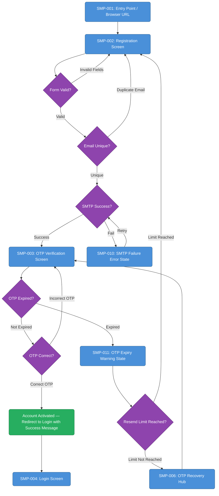
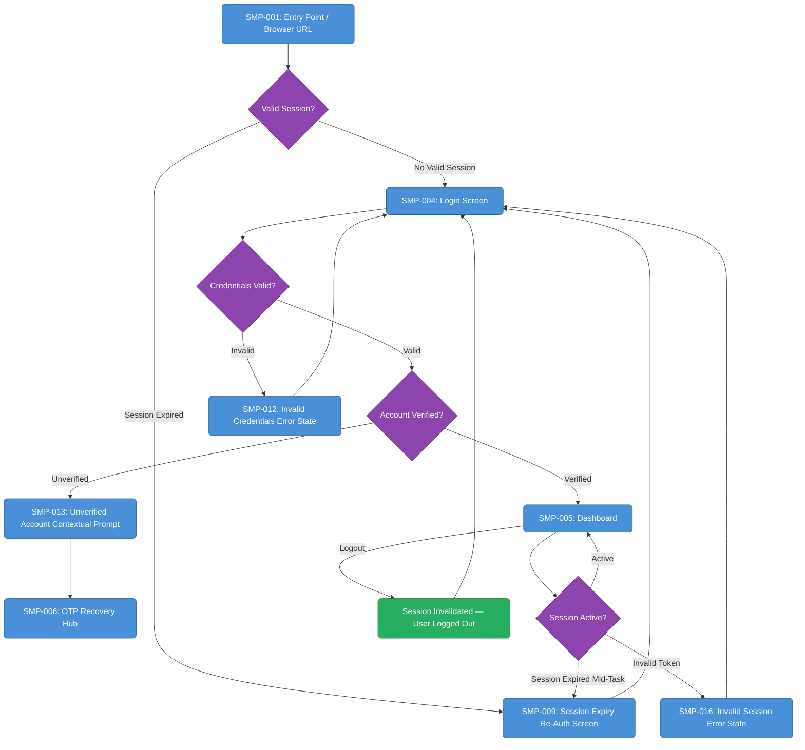
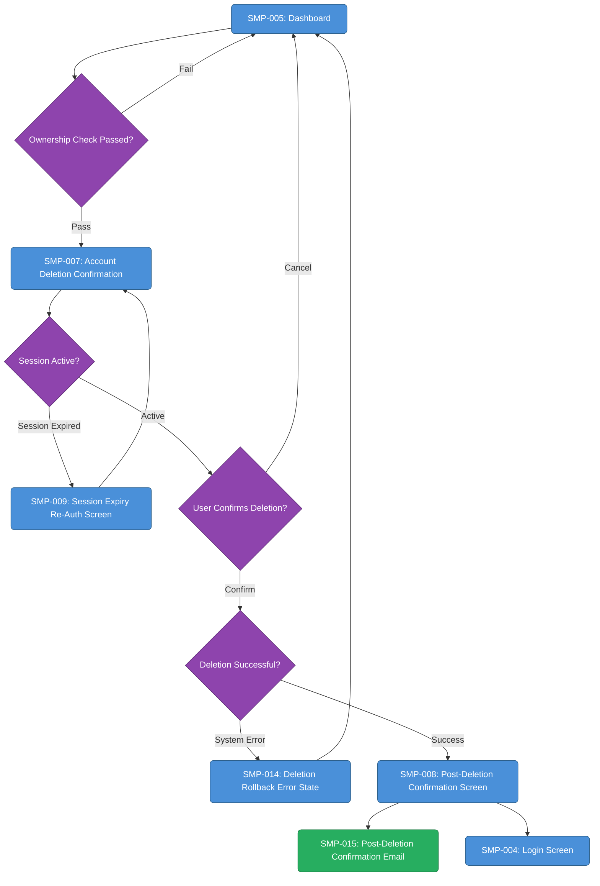
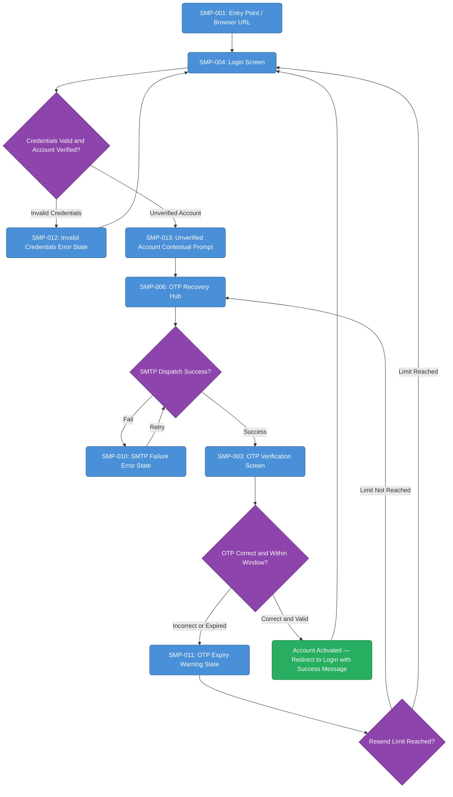
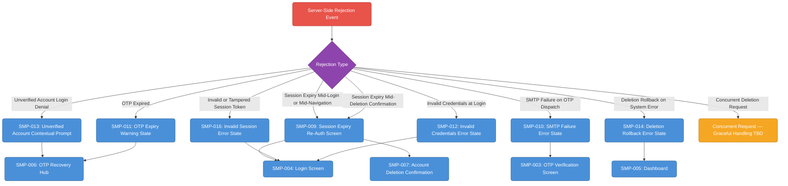

# User flows

## J-01 · New User Registration and OTP Verification (P-01: Maya Chen)
Covers the end-to-end happy path and all exception branches for a first-time registrant: form submission with inline validation, OTP dispatch, OTP entry within the 5-minute window, account activation, and all failure states (SMTP failure, OTP expiry, resend, browser-tab-close recovery).

### Diagram

## J-02 · Returning User Login and Session Management (P-02: Jordan Okafor)
Covers the returning authenticated user journey: expired-session redirect to login, credential validation, dashboard access, session continuity, mid-task session expiry handling, and explicit logout with server-side session invalidation.

### Diagram

## J-03 · Account Deletion Flow (P-03: Priya Nair)
Covers the full account deletion journey for an authenticated user: initiating deletion from the Dashboard, server-side ownership check, mandatory confirmation with itemised data scope, session-expiry-aware re-entry, atomic deletion, post-deletion confirmation screen and email, and deletion rollback error handling.

### Diagram

## J-04 · Stranded Registrant Recovery via OTP Recovery Hub (P-04: Sam Rivera)
Covers the recovery journey for a stranded registrant who closed the browser before OTP entry or whose OTP expired. Includes login denial with anti-enumeration-safe contextual prompt, navigation to the OTP Recovery Hub, new OTP request, OTP verification, and successful account activation.

### Diagram

## F-05 · Server-Side Rejection UX Layer — All Error State Coverage
Comprehensive map of every server-side rejection scenario and its paired user-facing error state with defined next-step actions. Covers: unverified-account login denial, session expiry mid-flow, SMTP failure, deletion rollback, OTP expiry, invalid/tampered session token, and concurrent request handling. Ensures zero silent failures across the full account lifecycle.

### Diagram

